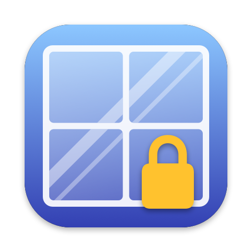

# TransparentLock

화면은 살짝 흐리고 어둡게 보이게 둔 채 마우스·키보드 입력만 막는 macOS 잠금 앱입니다.
Touch ID(또는 로그인 암호)로 인증해야 풀립니다.

고양이·아이·화면 청소 등으로 실수로 입력되는 걸 막는 용도입니다. 입력을 가로채는 덮개일 뿐이라
시스템 잠금 화면만큼 안전하지는 않습니다.

## 기능

- 모든 모니터를 덮는 반투명 창으로 클릭·스크롤·키 입력 차단
- Cmd+Tab 앱 전환, 강제 종료(Cmd+Opt+Esc), 로그아웃 단축키 비활성화
- 창 안에 내장된 Touch ID로 해제, 안 되면 "암호 사용" 버튼으로 로그인 암호 해제
- 흐림·어둡기 조절 (기본 흐림 4, 어둡기 0.4)

## 빌드와 설치

macOS 12 이상, Xcode Command Line Tools(`swiftc`)가 필요합니다.

```bash
./build.sh            # TransparentLock.app 빌드
./build.sh --install  # /Applications에 설치하고 Dock에 등록
```

## 사용법

- **실행:** 바로 잠깁니다.
- **⌥(Option) 누른 채 실행:** 설정 창이 열립니다. 슬라이더로 흐림·어둡기를 바꾸고, 5초 미리보기로 확인할 수 있습니다.

명령줄 옵션:

```bash
TransparentLock.app/Contents/MacOS/TransparentLock --test 30          # 30초 뒤 자동 해제(테스트용)
TransparentLock.app/Contents/MacOS/TransparentLock --blur 8 --dim 0.5 # 이번 실행만 값 지정
TransparentLock.app/Contents/MacOS/TransparentLock --settings         # 설정 창
```

## 참고

- 흐림은 비공개 API `CGSSetWindowBackgroundBlurRadius`로 반경을 지정합니다. 쓸 수 없는 환경에서는
  시스템 흐림 효과(`NSVisualEffectView`)를 반투명하게 깔아 대신합니다.
- 아이콘은 `make_icon.swift`가 코드로 그립니다.
